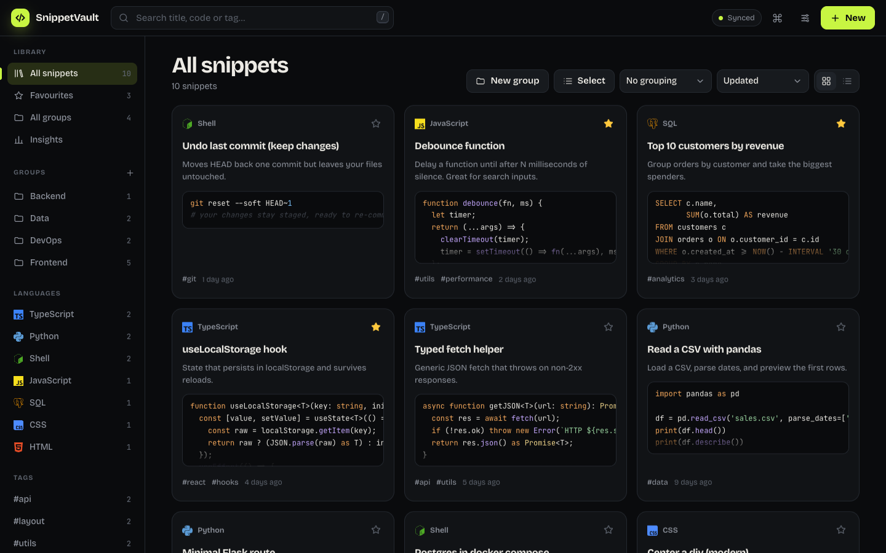
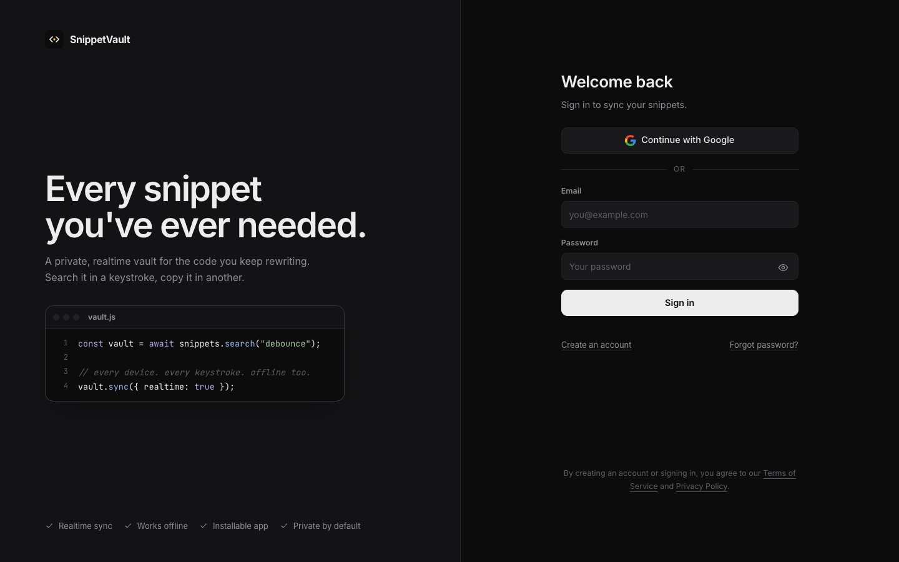
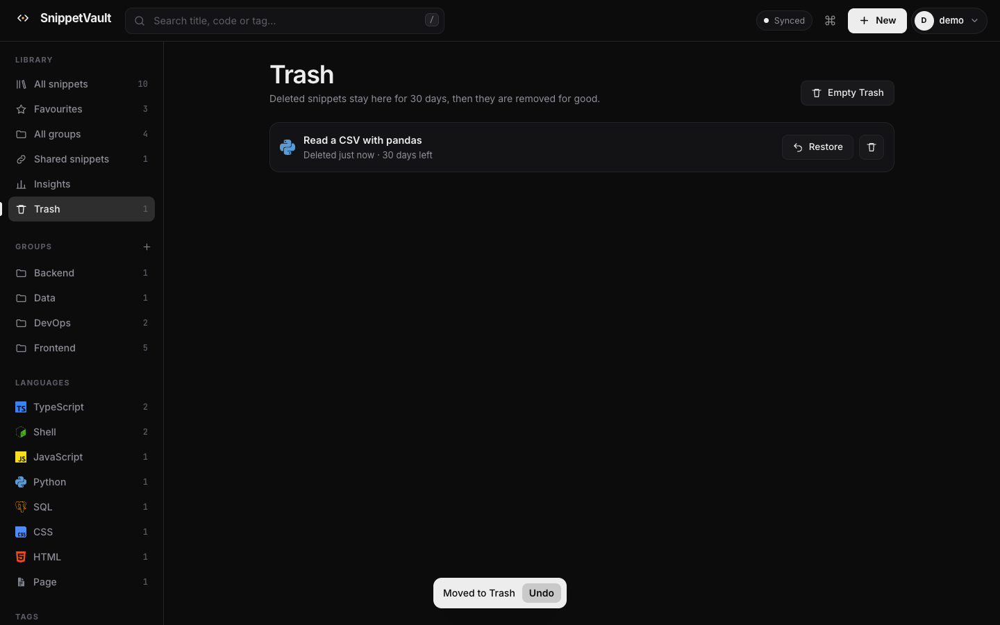
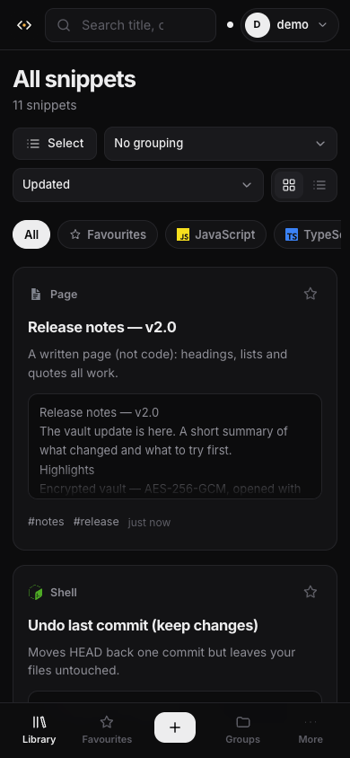

# SnippetVault

A private, realtime, offline-first vault for the code you keep rewriting. Search it in a keystroke, copy it in another, run it in the browser, share it as a read-only link, and lock the sensitive things in an encrypted vault.

[](https://github.com/islom-pardaboyev/snippetVault/actions/workflows/ci.yml)



<p align="center">
  
</p>

It runs as a **website**, an installable **PWA**, and a native **Android app** built from the same React code.

## Contents

- [Features](#features)
- [Tech stack](#tech-stack)
- [Quick start](#quick-start)
- [Configuration](#configuration)
- [Firebase setup](#firebase-setup)
- [Android app](#android-app)
- [Trash](#trash)
- [Vault, app lock and sharing](#vault-app-lock-and-sharing)
- [Admin](#admin)
- [Design system](#design-system)
- [Project structure](#project-structure)
- [Architecture notes](#architecture-notes)
- [Security](#security)
- [Testing and CI](#testing-and-ci)
- [Deploy](#deploy)
- [Screenshots](#screenshots)
- [Troubleshooting](#troubleshooting)
- [More documentation](#more-documentation)

## Features

### Library and search

- **Realtime sync, works offline.** Firestore with a persistent IndexedDB cache. Edits queue offline and sync when you're back.
- **Library views.** Grid or list, sorting, favourites, filters by language and tag, and grouping by group or language.
- **Smarter search.** Field operators (`lang:ts`, `tag:api`, `group:Frontend`, `is:starred`, `is:shared`, `has:notes`, `has:images`, `before:2026-01`, `after:2026-01-15`), typo-tolerant fuzzy matching, title-first ranking, quoted `"exact phrases"`, tappable filter chips and a recent-searches menu.
- **Command palette.** `⌘K` jumps to snippets, pages and actions.
- **Groups.** Topic folders with a colour and an emoji. Create a group from existing snippets, add more later, or drag a card onto a group in the sidebar.
- **Bulk actions.** Multi-select to move snippets to the Trash, or to delete whole groups.
- **Duplicate finder.** Warns on save when new code looks like something you already saved, and a "Possible duplicates" panel on Insights clusters near-identical snippets.
- **Insights.** A summary page for your library.

### Writing and using snippets

- **Editor.** CodeMirror 6 with 15+ languages, language auto-detect and `{{variable}}` templates that prompt for values before copying.
- **Private notes.** A rich-text note per snippet (Tiptap): headings, checklists, quotes, links, dividers, inline formatting and syntax-highlighted code blocks. Notes can show the snippet's images inline.
- **Pages.** Pick **Page** as the language to write prose instead of code. Pages behave like any other snippet: search, tags, groups, favourites, images, version history and share links all work.
- **Copy formats and code image.** A split copy button for raw code, Markdown, HTML, or title plus code, and export any block as a themed PNG.
- **Run code in the browser.** JavaScript, TypeScript and Python (Pyodide) run in a sandboxed iframe and Web Worker with a timeout.
- **Version history** with line diffs, **image attachments** (up to five per snippet), JSON import and export, and Markdown export.
- **Trash.** Deleted snippets are kept for 30 days and can be restored. See [Trash](#trash).

### Privacy and sharing

- **Encrypted vault.** Client-side AES-256-GCM, with a passphrase and an optional recovery key. Holds encrypted images and audio (voice messages, music). See [Vault, app lock and sharing](#vault-app-lock-and-sharing).
- **App lock.** A passcode screen for the device, with auto-lock.
- **Read-only share links.** Publish a snippet or a whole group to an unguessable link that anyone can open without an account, with an optional expiry and a view counter.
- **Shared snippets page.** `/shared` lists everything you've published, with copy, open and revoke.

### Accounts and admin

- **Auth.** Email and password, **Sign in with Google** (a native account picker in the Android app), password reset, email verification, change password and delete account.
- **Account menu.** Your name, email and sign-in method, with links to Settings, Admin, the theme toggle and Sign out.
- **Admin.** A passcode-protected dashboard for the site owner. See [Admin](#admin).

### Look and feel

- **Monochrome design.** Light, dark and system themes. Colour appears only in code and in danger states. See [Design system](#design-system).
- **Responsive.** Down to pocket-phone widths, with a bottom bar on phones (Library, Favourites, **+**, Groups, **More**). The bar carries the only "New" button on a phone.
- **Installable.** A PWA with offline support and a share target, plus a native Android app.

### Keyboard shortcuts

| Shortcut | Action |
| --- | --- |
| `⌘ K` | Command palette |
| `/` | Focus search |
| `N` | New snippet |
| `D` | Toggle dark and light |
| `C` / `E` / `F` / `R` | Copy, edit, favourite, run (on a snippet) |
| `⌘ ↵` / `⌘ ⇧ ↵` | Save / run (in the editor) |
| `Esc` | Go back |

## Tech stack

| Area | Choice |
| --- | --- |
| UI | React 19, React Router 7, TypeScript |
| Styling | Tailwind CSS 4 with design tokens in `src/index.css`, Inter and JetBrains Mono |
| Build | Vite, with `vite-plugin-pwa` for the service worker and manifest |
| Backend | Firebase Authentication and Cloud Firestore, no custom server |
| Editor and notes | CodeMirror 6, Tiptap 3 with `lowlight` |
| Android | Capacitor 8 with the Capacitor Firebase authentication plugin |
| Tests | Vitest and jsdom |

## Quick start

You need **Node 22 or newer** and npm.

```bash
npm install
npm run dev        # http://localhost:5173
```

To look around without a Firebase account, open `http://localhost:5173/?demo=1`. Demo mode seeds snippets in memory, is compiled out of production builds, and can't publish share links.

### Scripts

| Command | What it does |
| --- | --- |
| `npm run dev` | Start the Vite dev server |
| `npm run build` | Typecheck, then build for production into `dist/` |
| `npm run preview` | Serve the production build locally |
| `npm test` | Run the unit tests once |
| `npm run typecheck` | `tsc --noEmit` |
| `npm run deploy` | Build, then `firebase deploy` (hosting and rules) |
| `npm run android:sync` | Build the web app and copy it into the Android project |
| `npm run android:apk` | Sync, then build the signed release APK |

> `npm install` needs `legacy-peer-deps`, which the repo already sets in `.npmrc`. The Capacitor Firebase plugin declares an older optional `firebase` peer than the version this app uses, and without the setting npm stops with `ERESOLVE`. This also applies to Vercel and CI.

## Configuration

Copy `.env.example` to `.env.local` (git-ignored) and fill it in. Restart `npm run dev` after changing it.

| Variable | Purpose |
| --- | --- |
| `VITE_ADMIN_EMAIL` | The only account that can open `/admin`. If unset, a default in `src/lib/admin.ts` applies, so set your own. |
| `ADMIN_PASSCODE` | The admin passcode as plain text. It is hashed at build time, and only the SHA-256 reaches the site. Use 12 or more characters. |
| `IMB_API` | **Optional.** An imgbb API key that gives the Vault unlimited images and hosts its audio. Without it, vault images are stored inline in Firestore and audio can't be added. |

> **Vault images and audio.** With `IMB_API` set, an image added in the Vault is compressed, AES-GCM-encrypted on your device, wrapped in a lossless greyscale PNG, uploaded to imgbb, then downloaded straight back and SHA-256-verified before a ~300-byte pointer is saved to Firestore. If imgbb is unavailable, out of quota, or alters the bytes, the image falls back to inline (still encrypted) storage, so nothing is lost. The site is client-only, so the key ships inside the JavaScript bundle. Use a key you can rotate. imgbb only ever sees ciphertext. Vault audio goes through the same host and the same upload-and-verify steps, but it requires `IMB_API` and never falls back to inline storage. See [Vault audio](#vault-audio).

## Firebase setup

One-time, in the Firebase console for the project (the web config is already in `src/lib/firebase.ts`):

1. **Build, Authentication, Sign-in method:** enable **Email/Password** and **Google**, and pick a support email.
2. **Authentication, Settings, Authorized domains:** add your deployed domain. `localhost` is allowed by default.
3. **Build, Firestore Database:** create the database in production mode.
4. **Rules:** deploy `firestore.rules`. Rules never deploy with Vercel, so always run:

   ```bash
   npx firebase-tools deploy --only firestore:rules --project snippetvault-ed43b --non-interactive
   ```

The Firebase web config in the repo is a public project identifier, not a secret. Access is enforced by Auth and the rules.

## Android app

The Android app is the web app wrapped by [Capacitor](https://capacitorjs.com). The web build is **bundled inside the APK**, so it does not load the live site. An app update means building and installing a new APK. Your data lives in your account, so installing over the old app keeps everything.

| | |
| --- | --- |
| Package | `com.snippetvault.app` |
| Minimum Android | 8.0 (API 26) |
| Config | `capacitor.config.ts`, and the Android project in `android/` |

### Prerequisites

- **JDK 21.** Capacitor 8 needs it. JDK 17 fails with `invalid source release: 21`.
- The **Android SDK** (`ANDROID_HOME`), installed with Android Studio or the command-line tools.

### Signing

The release APK is signed with your own keystore. Keep the keystore and its passwords **out of git**. They are ignored already.

1. Put the keystore at the repo root as `android.keystore`. To create one:

   ```bash
   keytool -genkeypair -v -keystore android.keystore -alias android \
     -keyalg RSA -keysize 2048 -validity 10000
   ```

2. Copy `android/keystore.properties.example` to `android/keystore.properties` and fill it in:

   ```properties
   storeFile=../android.keystore
   storePassword=...
   keyAlias=android
   keyPassword=...
   ```

> Keep a backup of the keystore. Every future update has to be signed with the same key.

### Google sign-in on Android

The Android WebView can't open the Google popup, so the app uses a native account picker (`@capacitor-firebase/authentication`) and hands the Google ID token to the Firebase JS SDK, which signs you in as the same user (`src/hooks/auth.tsx`). It needs one-time setup:

1. In the Firebase console, add an **Android app** with package `com.snippetvault.app`, and download its `google-services.json` into `android/app/`.
2. Register your keystore's **SHA-1** fingerprint on that Android app:

   ```bash
   keytool -list -v -keystore android.keystore -alias android | grep SHA1
   npx firebase-tools apps:android:sha:create <APP_ID> <SHA1> --project snippetvault-ed43b
   ```

`rgcfaIncludeGoogle=true` in `android/gradle.properties` turns on the plugin's Google support. The Firebase CLI also lists your apps with `apps:list ANDROID`.

### Build and publish the APK

```bash
export JAVA_HOME=/path/to/jdk-21
npm run android:apk
# result: android/app/build/outputs/apk/release/app-release.apk
```

To offer it on the website:

1. Copy the file to `public/snippetvault.apk`.
2. Set `ANDROID_APK_PUBLISHED = true` in `src/lib/native.ts`. While it is `false` the download button is hidden, because the site's catch-all rewrite would otherwise answer the missing file with `index.html`.
3. Deploy. On the sign-in page, **Android browsers** now see a **Download the Android app** button.

To install on a connected device or emulator:

```bash
adb install -r public/snippetvault.apk
```

### How the app differs from the website

- **Insets.** Android draws apps edge to edge. Capacitor reports the status-bar and gesture-bar sizes as CSS variables, and `src/index.css` pads the page and paints a status-bar strip with `--inset-top` and `--inset-bottom`.
- **Status bar.** `src/lib/native.ts` keeps the system bar colour and icon style in step with the theme.
- **App icon and splash.** Generated from `assets/` with `npx @capacitor/assets generate --android --assetPath assets`.

## Trash

Deleting a snippet moves it to the **Trash**, which is in the web sidebar and in the **More** menu on phones.

- A deleted snippet is kept for **30 days**, with its images and version history, so **Restore** brings back everything.
- Restore one, restore all, **delete forever**, or **Empty Trash** (each destructive action asks first).
- Anything older than 30 days is removed automatically, **with its images, history and share link**. This runs in the app when it loads and then hourly, so it needs no server job. It happens the next time the app is opened after the deadline.
- Trashing a **shared** snippet turns its public link off immediately.
- Deleting a group together with its snippets moves those snippets to the Trash.
- Moving a snippet **into the Vault** skips the Trash on purpose and deletes the plaintext copy permanently. A copy waiting in the Trash would defeat the Vault.

Technically it is a soft delete: a `deleted_at` timestamp on the snippet document. The retention rules live in `src/lib/trash.ts` and the actions in `src/hooks/snippets.tsx`.

## Vault, app lock and sharing

### Vault

A private section for secrets. Everything in it is encrypted on your device before it is stored.

- Passphrase, then **PBKDF2-HMAC-SHA-256 (600,000 iterations)**, then a key-encryption key that wraps a random 256-bit data key.
- Every field (title, code, notes, images, history) is **AES-256-GCM** encrypted with a fresh IV and per-item AAD.
- An optional **recovery key**, shown once when you create the vault. Losing both the passphrase and the recovery key loses the data. Nothing server-side can recover it.
- **Forgot the passphrase?** On the locked screen choose **Forgot your passphrase? Use your recovery key**, then set a new passphrase. Everything in the vault stays readable, and the recovery key keeps working.
- **No passphrase and no recovery key?** The vault can't be opened, only erased. **Reset the vault** (on the same screen, after typing `RESET`) permanently deletes the vault's items and images and lets you set up a new one. Your normal snippets are untouched.
- Moving a snippet in removes **every** plaintext copy: the document, its images, its version history and its share link.

#### Vault audio

Voice messages and music can be stored in the Vault, either in the standalone **Voice & music** section or attached to a vault item.

- **Limit and types.** Up to 25 MB per file. MP3, M4A, OGG, WAV and WebM are accepted.
- **Needs `IMB_API`.** Audio is hosted on imgbb the same way as vault images (encrypted, wrapped in a PNG, uploaded, downloaded back and SHA-256-verified). There is **no inline fallback**: if audio can't be hosted and verified, it isn't added. Without `IMB_API` the Add audio button is disabled.
- **Encrypted separately.** The file name, type, size and duration are sealed as `meta`, apart from the audio bytes. The only plaintext field is `created_at` on standalone audio, used to sort the list. Playback decrypts in memory and plays from a `blob:` URL.
- **Move out is refused while an item has audio.** Normal snippets can't hold audio, so remove the item's audio first.
- **Deleting is thorough.** Deleting an audio file, a vault item, resetting the vault or deleting your account removes the audio records, and asks imgbb to delete the hosted blobs on a best-effort basis.
- **imgbb may not keep files forever.** Hosted blobs can be removed or lost on imgbb's side, and then that audio can't be played back. Keep the originals of any music you can't replace.

### App lock

A passcode screen (4 to 12 digits) with auto-lock after 0, 1, 5 or 30 minutes, or never. It is a **device privacy screen, not encryption**. The code is stored per device and stops someone who picks up your unlocked device. Use the Vault for anything that must stay secret.

### Share links

Publishing writes a **separate public copy** to `shares/{token}`. The token is unguessable, and anyone with it can read the copy without an account. You can set an expiry (1 hour to 30 days), watch a view counter, refresh the contents, or revoke it. **Expiry is enforced by the Firestore rules**, so an expired link is unreadable even to someone who kept the URL.

## Admin

`/admin` has two gates. The page is shown only to the account in `VITE_ADMIN_EMAIL`, and then it asks for the admin passcode once per browser session. It shows counts, sync state, local storage use, a JSON export of your vault, and a table of registered accounts from the public `users` directory.

> **Security note.** `VITE_*` values are compiled into the JavaScript bundle, so anyone can read the passcode hash and the admin email. The passcode gate keeps casual visitors out, but it is not a real security boundary. The protection for real data is the Firestore rules, which only let each user touch their own documents. For a true admin view of all users, use a Firebase custom claim with a Cloud Function.

## Design system

The interface is deliberately **monochrome**. The accent is the ink colour itself (near-white on dark, near-black on light), so primary actions and focus rings stay quiet. Colour appears only in syntax highlighting and for danger.

- **Tokens** live in `src/index.css` (`--bg`, `--surface`, `--line`, `--text`, `--muted`, `--accent`, `--t-*` for syntax).
- **Shared classes:** `.btn`, `.btn-primary`, `.btn-ghost`, `.btn-danger`, `.chip` and `.field` (every text input).
- **Type:** Inter for the interface and JetBrains Mono for code.
- Check light, dark and a 375px phone width before calling a screen done.

The full rules are in [`DESIGN.md`](DESIGN.md), and the product context is in [`PRODUCT.md`](PRODUCT.md).

## Project structure

```text
src/
  pages/        Login, Library, Detail, Editor, Groups, Shared, SharedSnippets, Trash,
                Vault, Insights, Admin, Legal, Offline, NotFound
  components/   Shell, CommandPalette, SettingsDialog, RichNote, CodeEditor, Modal, ...
  hooks/        auth, snippets, vault, applock, ui (theme, toasts, install), images
  lib/          search, share, crypto, vault, trash, native, runner + sandbox, utils, ...
android/        Capacitor Android project (signing config reads keystore.properties)
assets/         Source images for the app icon and splash
public/         Icons, favicon, snippetvault.apk
docs/           security.md, vault-and-app-lock-plan.md, screenshots/
scripts/        capture-screenshots.py
firestore.rules Per-user isolation, size and shape validation, share expiry
```

## Architecture notes

| Area | Notes |
| --- | --- |
| `src/hooks/auth.tsx` | Auth context: email and password, Google (popup on web, native picker on Android), reauth and password change, verification state. Writes a row to the `users` directory on sign-in |
| `src/hooks/snippets.tsx` | Single source of truth: Firestore snapshot listeners, optimistic local updates, batched writes, groups, versions, Trash (soft delete, restore, purge, auto-purge) |
| `src/lib/trash.ts` | The 30-day retention rule: `isExpired` and `daysLeft` |
| `src/lib/native.ts` | Capacitor helpers: native app detection, the APK URL and publish flag, status-bar sync |
| `src/lib/search.ts` | Query parser (field operators), fuzzy matcher and recent searches, shared by the library and the palette |
| `src/lib/similar.ts` | Duplicate detection: normalised fingerprints plus a word-overlap (Sørensen–Dice) score |
| `src/lib/share.ts` | Share links: create, read, revoke, expiry and view counter. Expiry is stored as an ISO string for the UI and a Firestore timestamp (`expires_at_ts`) so the rules can refuse an expired link |
| `src/lib/codeImage.ts` | Renders a snippet to a themed PNG on a canvas, with no third-party dependency |
| `src/lib/runner.ts`, `src/lib/sandbox/` | Sandboxed execution: opaque-origin iframe, Web Worker, kill on timeout |
| `src/lib/highlight.ts` | Dependency-free highlighter for card previews and the code image |
| `src/components/RichNote.tsx`, `src/lib/note.ts` | Rich notes: one Tiptap document in two shapes (editor and read-only view), stored as HTML |
| `src/lib/crypto.ts`, `src/lib/vault.ts`, `src/lib/container.ts` | Vault cryptography, vault storage, and the image container format |
| `src/lib/vault-audio.ts` | Vault audio: type and size checks, sealing and verified hosting (no inline fallback), the sealed `meta`, Firestore records for item audio and the standalone list, and the Move-out rule |
| `src/lib/applock.ts` | App passcode hashing and auto-lock options |
| `src/lib/utils.ts` | Language list, the **Page** type, export and import, seed data |
| `firestore.rules` | Per-user isolation (`users/{uid}/...`) plus size and shape validation on every write (including hosted vault audio at `users/{uid}/vault/{itemId}/audio` and `users/{uid}/vaultAudio`), and public read-only `shares/{token}` with server-enforced expiry |

## Security

- **Isolation.** Every document lives under `users/{uid}`. Rules only allow that uid to read or write it, and writes are validated for type and size.
- **Account deletion** (Settings, Danger zone) re-confirms the sign-in, deletes every document the user owns, then deletes the Firebase account.
- **Share links are a separate public copy,** so your private data and rules are untouched. Only the owner can create or delete a share, and anonymous readers can only bump the view counter by one.
- **Permanent deletion is thorough.** Firestore never cascades to sub-collections, so deleting a snippet for good (and moving it into the Vault) explicitly removes its images, version history and share link.
- **Sandboxed code.** User code never runs in the app's origin. The iframe has no `allow-same-origin`, so it can't read cookies, storage or the Vault.
- **Headers.** A Content-Security-Policy and other security headers are set in `firebase.json` and `vercel.json`.
- **Known and accepted risks,** the CSP rationale and the pre-ship checklist are in [`docs/security.md`](docs/security.md).

## Testing and CI

```bash
npm test
npm run typecheck
npm run build
```

Tests cover the search parser, duplicate detection, crypto and the container format, the vault and its cleanup, hosted-image deletion, app lock, notes, admin pairing, the Trash retention rules, and the rich-note editor. GitHub Actions runs the type-check, the tests and a production build on every push and pull request (`.github/workflows/ci.yml`).

## Deploy

```bash
npm run deploy     # build, then firebase deploy (hosting and rules)
```

The static host can be **Firebase Hosting** or **Vercel**, and both are configured:

- **SPA fallback and security headers** live in `firebase.json` *and* `vercel.json`. Vercel needs its own copy, and deep links like `/share/<token>` return 404 without the rewrite. Keep the two in sync.
- On **Vercel**, import the repo, then set `ADMIN_PASSCODE`, `VITE_ADMIN_EMAIL` and the optional `IMB_API` in Project Settings. The repo's `.npmrc` makes `npm install` succeed.
- **Firestore rules never deploy with Vercel.** After touching `firestore.rules`, run the `firebase-tools deploy --only firestore:rules` command from [Firebase setup](#firebase-setup).
- The Android APK is a static file in `public/`, so deploying the site publishes it.

## Screenshots

| Sign in | Group with existing snippets |
| --- | --- |
|  |  |

| Trash | Phone |
| --- | --- |
|  |  |

`scripts/capture-screenshots.py` regenerates everything in `docs/screenshots/` from the dev server in demo mode. It needs Google Chrome, `pip install playwright pillow`, and the dev server running. Point it at a different address with `BASE_URL`:

```bash
BASE_URL=http://localhost:5173 python3 scripts/capture-screenshots.py
```

## Troubleshooting

| Problem | Fix |
| --- | --- |
| `vite: command not found` | Dependencies are missing. Run `npm ci`. |
| `ERESOLVE` on install (locally or on Vercel) | `.npmrc` must contain `legacy-peer-deps=true`. It is committed, so make sure the file is in the repo you're building. |
| `invalid source release: 21` building the APK | Use JDK 21. Set `JAVA_HOME` to it before `npm run android:apk`. |
| Forgot the Vault passphrase | Use your recovery key on the locked Vault screen to set a new passphrase. Without a recovery key, use **Reset the vault** to start over (this deletes the vault's contents). |
| `keystore password was incorrect` | The password in `android/keystore.properties` doesn't match `android.keystore`. |
| The download button saves an HTML file | `public/snippetvault.apk` is missing, and the site's rewrite served `index.html`. Publish the APK first. |
| Google sign-in does nothing in the Android app | The Android app needs `google-services.json` in `android/app/` and your keystore's SHA-1 registered in Firebase. |
| The app doesn't show a new feature | The APK bundles the web build. Build a new APK and install it over the old one. |
| The status bar covers the page on Android | Rebuild the APK from the latest code. The inset handling is in `src/index.css`. |

## More documentation

- [`SETUP.md`](SETUP.md): a short setup checklist.
- [`docs/security.md`](docs/security.md): security architecture, CSP rationale, hosting matrix, accepted risks and the pre-ship checklist.
- [`docs/vault-and-app-lock-plan.md`](docs/vault-and-app-lock-plan.md): the design record for the Vault, app lock and unlimited images.
- [`DESIGN.md`](DESIGN.md) and [`PRODUCT.md`](PRODUCT.md): the design system and the product context.
