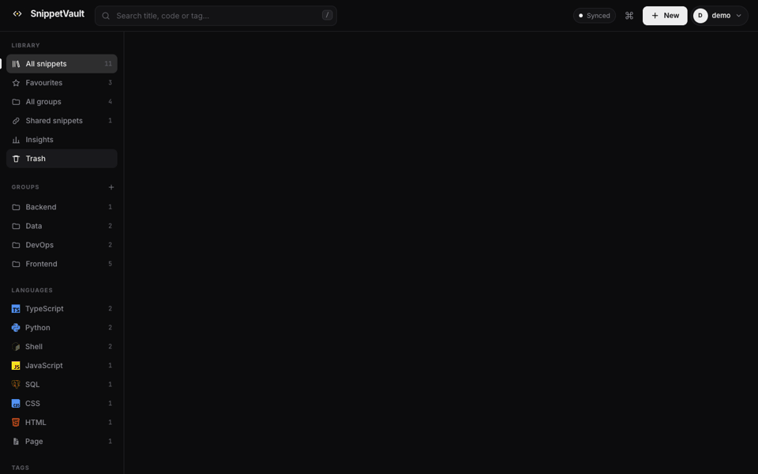
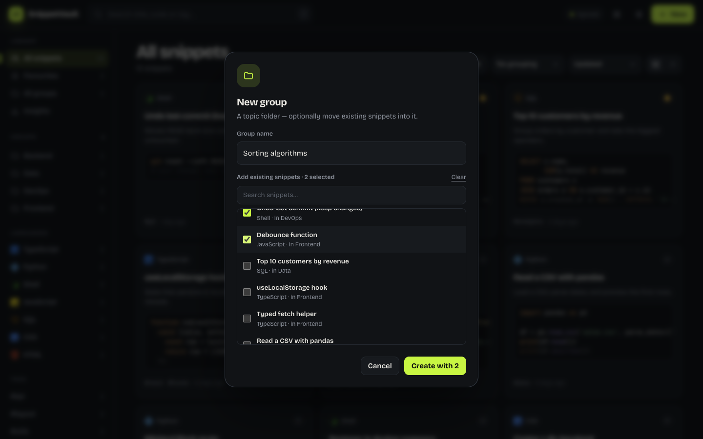

# SnippetVault

A private, realtime, offline-first vault for the code you keep rewriting. Search it in a keystroke, copy it in another, run it in the browser.


<p align="center">
  
</p>

Built with **React 19 · TypeScript · Tailwind CSS 4 · Vite · Firebase (Auth + Firestore) · CodeMirror 6**, installable as a PWA.

## Features

- **Auth** — email/password and **Sign in with Google**, password reset, email verification, change password, delete account
- **Admin** — `/admin` for the site owner: passcode-protected dashboard (see [Admin](#admin))
- **Realtime sync, works offline** — Firestore with a persistent IndexedDB cache; edits queue offline and sync when you're back
- **Library** — grid/list views, sort, favourites, filter by language and tag, full-text search, command palette (`⌘K`)
- **Groups** — topic folders with colour and emoji; create a group from existing snippets, add existing snippets later, drag a card onto a group in the sidebar
- **Bulk actions** — multi-select to delete snippets (everywhere, including inside a group) or whole groups, with Undo
- **Run code in the browser** — JavaScript, TypeScript and Python (Pyodide) execute inside a sandboxed iframe + Web Worker with a timeout, so a runaway loop can't touch the app or your data
- **Editor** — CodeMirror 6 with 15+ languages, language auto-detect, `{{variable}}` templates that prompt before copying
- **Version history** with line diffs, **image attachments**, JSON import/export, Markdown export
- **Insights** page, light/dark/system theme and custom accent colour

| Sign in | Group with existing snippets | Mobile |
| --- | --- | --- |
|  |  |  |

## Run locally

```bash
npm install
npm run dev        # http://localhost:5173
npm test           # unit tests (Vitest)
npm run typecheck
npm run build
```

Firebase setup (Email/Password + Google providers, Firestore, rules) is in [SETUP.md](SETUP.md).

To look around without a Firebase account, run `npm run dev` and open `http://localhost:5173/?demo=1`. Demo mode is compiled out of production builds, and the snippets are seeded in memory.

### Environment

Copy `.env.example` to `.env.local` (git-ignored) and fill in:

| Variable | Purpose |
| --- | --- |
| `VITE_ADMIN_EMAIL` | The only Google/email account that can open `/admin` |
| `ADMIN_PASSCODE` | The admin passcode as plain text. It is hashed at build time; only the SHA-256 reaches the site. |

## Admin

`/admin` has two gates. The page is shown only to the account in `VITE_ADMIN_EMAIL`, and then it asks for the admin passcode once per browser session. It shows counts, sync state, local storage use, a JSON export of your vault, and a link to the Firebase user list.

> **Security note.** `VITE_*` values are compiled into the JavaScript bundle, so anyone can read the hash and the admin email. The passcode gate keeps casual visitors out, but it is not a real security boundary. The protection for real data is the Firestore rules, which only let each user touch their own documents. For a true admin view of all users, use a Firebase custom claim with a Cloud Function, which the client can't see or forge.

## Architecture notes

| Area | Notes |
| --- | --- |
| `src/hooks/auth.tsx` | Auth context: email/password, Google popup, reauth + password change, verification state |
| `src/hooks/snippets.tsx` | Single source of truth: Firestore snapshot listeners, optimistic local updates, batched writes, groups, versions |
| `src/lib/runner.ts`, `src/lib/sandbox/` | Sandboxed code execution (opaque-origin iframe → Web Worker, kill-on-timeout) |
| `src/lib/highlight.ts` | Dependency-free highlighter used for card previews |
| `firestore.rules` | Per-user isolation (`users/{uid}/…`) plus size and shape validation on every write |

### Security

- Account deletion (Settings → Danger zone) re-confirms the sign-in, deletes every document the user owns, then deletes the Firebase account.
- Every document lives under `users/{uid}` and rules only allow that uid to read or write it; writes are validated for type and size.
- User code never runs in the app's origin: the sandbox iframe has no `allow-same-origin`, so it can't read cookies, storage or the vault.
- The Firebase web config in the repo is a public project identifier, not a secret — access is enforced by Auth and the rules above.

## CI

GitHub Actions runs type-check, tests and a production build on every push and pull request (`.github/workflows/ci.yml`).

## Screenshots

`scripts/capture-screenshots.py` regenerates `docs/screenshots/` from the dev server in demo mode. It needs Google Chrome, `pip install playwright pillow`, and `npm run dev` running.

## Deploy

```bash
npm run deploy     # build + firebase deploy (hosting and rules)
```
